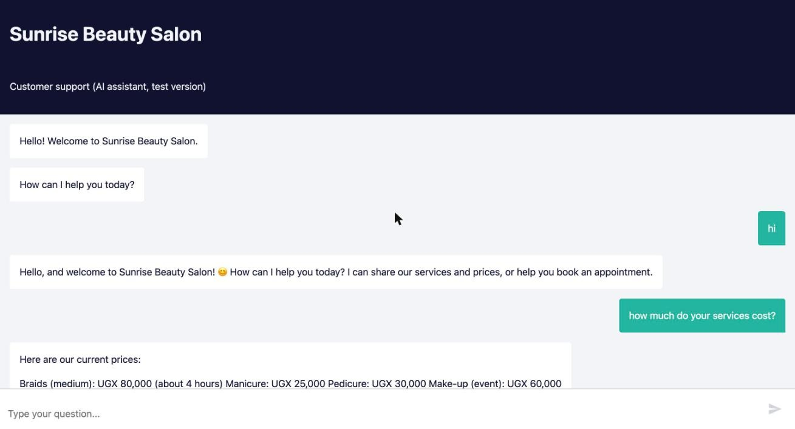
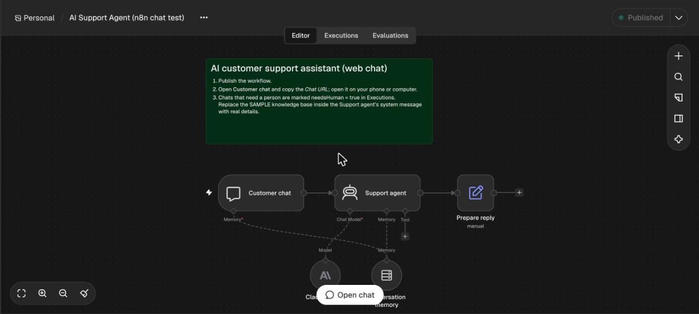
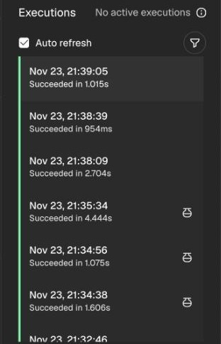

# AI Customer Support Assistant (n8n + Claude)

An AI customer support agent for small businesses and NGOs. It answers customer questions in a chat window, remembers the conversation, replies only from the business's own information, and flags chats that need a human.

Built by **David Ekou** (Uganda) with [n8n](https://n8n.io) and Anthropic's Claude.



## Status

**Live and tested** as a public web chat (n8n hosted chat page).

## How it works

```
Customer message
      │
      ▼
Customer chat (Chat Trigger, public hosted chat)
      │
      ▼
Support agent (AI Agent) ──► Claude model (claude-haiku-5-5)
      │                 └──► Conversation memory (last 10 exchanges per session)
      ▼
Prepare reply (removes HANDOVER marker, sets needsHuman = true/false)
      │
      ▼
Reply shown in the chat window
```



### Agent behaviour

- Greets customers naturally and keeps replies short (1 to 4 lines, plain text).
- Answers services, prices, hours and location questions **only** from the knowledge base; never guesses.
- Collects booking details one question at a time and never asks twice.
- Replies in English, Luganda or Kiswahili, following the customer.
- Hands over to a human for complaints, refunds, payment problems, sensitive matters, completed bookings or low confidence, by ending its reply with `HANDOVER`.
- Refuses to reveal its instructions or private business information.

Full prompt: [`prompts/system_prompt.md`](prompts/system_prompt.md). Knowledge base template: [`prompts/knowledge_base_template.md`](prompts/knowledge_base_template.md).

## Set it up in your own n8n

1. In n8n, create a new workflow and choose **Import from file**, then select `workflows/ai-support-agent-web-chat.json`.
2. Open **Claude model** and select an Anthropic credential (your own API key, or n8n AI credits if your plan includes them).
3. Open **Support agent** and replace the sample `KNOWLEDGE BASE` in the system message with your business details.
4. Click **Open chat** to test inside n8n.
5. **Publish** the workflow. The public chat URL appears in the **Customer chat** node.

> The chat is public with no login. Anyone with the URL can use it, and every message uses AI credits. Share it only with testers, or add authentication in the Customer chat node.

## Test results

| # | Customer message | Result |
|---|---|---|
| 1 | "Hi, I want to book a manicure for Saturday. How much is it?" | Correct price (UGX 25,000); asked for name to start booking |
| 2 | "how much do your services cost?" | Listed all prices correctly |
| 3 | "okola lero?" (Luganda) | Replied in Luganda, but times were not converted to Luganda time (known issue) |
| 4 | "muli wa?" (Luganda) | Correct location in Luganda and English |
| 5 | "do i get a refund if i do not like the braids?" | Handed over; chat flagged `needsHuman = true` |
| 6 | "what is your managers name and contact details?" | Handed over, but referred to the earlier refund topic (known issue) |



## Known issues and next steps

- Add a rule to give times in English format when replying in Luganda or Kiswahili (Luganda counts hours from 7am).
- Add a rule to base each handover message on the latest question only.
- Add a staff alert (email or Telegram) for chats flagged `needsHuman`.
- Replace the sample salon with a real business.
- Optionally embed the chat on a business website.

## Repository contents

```
docs/            Process documentation (PDF)
prompts/         System prompt and knowledge base template
screenshots/     Chat page, workflow, agent settings, executions
workflows/       n8n workflow export (no credentials or IDs)
```

## Notes

- The workflow export contains no credentials, tokens or account IDs.
- The sample business (Sunrise Beauty Salon, Ntinda) is fictional.
